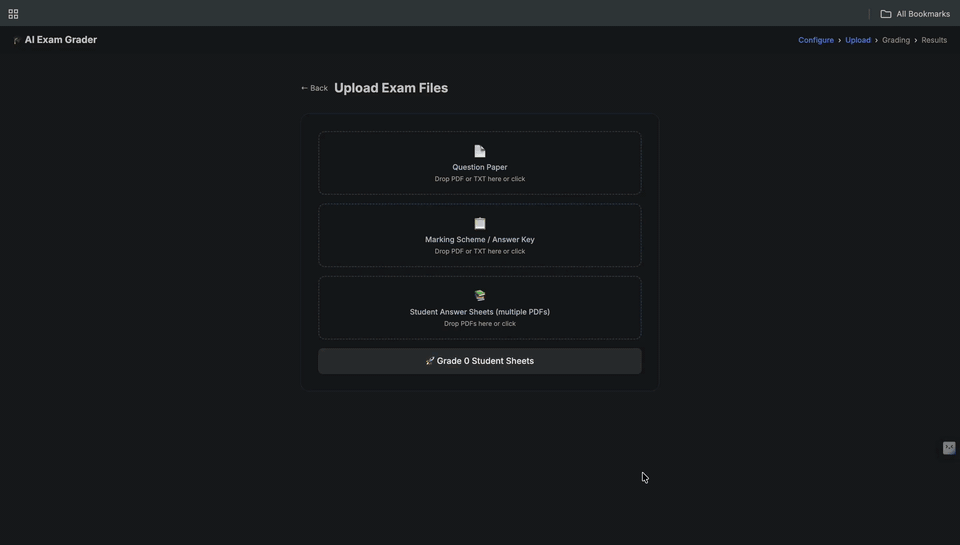

# 🎓 Smart Grade Assistant

An end-to-end **AI-powered handwritten exam grading system** that transcribes multi-page scanned student answer sheets, evaluates both **MCQs** and **short-answer questions** against a marking scheme, streams live grading progress, and generates **parent-friendly progress reports** with CSV exports.

---

## 🎥 Full Workflow Demo



> *2× speed auto-playing preview — **[▶ Watch Full HD Recording (`DEMO.mp4`)](./DEMO.mp4)***

---

## ✨ Key Features

- **Two-Stage Handwritten OCR (Eliminates Hallucinations):**
  - **Stage 1 (`qwen/qwen3.8-27b` Vision):** Converts multi-page PDFs into bounded-resolution images via PyMuPDF (no Poppler dependency) and performs verbatim plain-text OCR while ignoring red-ink teacher marks and reverse-side paper bleed-through.
  - **Stage 2 (`openai/gpt-oss-120b`):** Uses the parsed question list to match answers to their true question numbers—automatically correcting misread handwritten digits (e.g., `28` vs `29`, `25` vs `35`, `31` vs `25`).
- **Deterministic MCQ Grading + Rubric-Based Short Answer Grading:**
  - MCQs are graded in code against the answer key (`0` extra LLM calls).
  - Short answers are graded question-by-question against extracted criteria with partial-credit support, quoted evidence, teacher review flags, and **prompt-injection defense**.
- **Real-Time Progress Tracking (SSE):**
  - Live stage tracker (`Marking Scheme` → `Reading Answers` → `Checking Questions` → `Writing Report`), current-action banner, elapsed timer, smooth progress bar, and live terminal log.
- **Automatic API Key Rotation:**
  - Supports multiple comma-separated Groq API keys (`GROQ_API_KEYS`) with instant round-robin rotation whenever an HTTP `429` rate limit is hit.
- **Results Dashboard & Exports:**
  - Class summary metrics (average, pass rate, highest/lowest), expandable per-student breakdowns (MCQ grid, short-answer transcripts & feedback, parent letters), one-click **CSV** gradebook export, and **TXT** parent report bundle.

---

## 🏗️ Architecture & Tech Stack

| Layer | Technology | Purpose |
| :--- | :--- | :--- |
| **Frontend** | React 18, Vite, Tailwind CSS | 4-step workflow UI, drag-and-drop uploads, SSE progress stream, results dashboard |
| **Backend** | Python 3.12, FastAPI, Uvicorn | Async job execution, SSE streaming (`/api/jobs/{id}/stream`), CSV/report exports |
| **PDF Processing** | PyMuPDF (`fitz`) | Pure-Python PDF text extraction & capped-resolution JPEG rendering |
| **Vision OCR** | Groq (`qwen/qwen3.8-27b`) | Handwritten answer sheet transcription |
| **Reasoning & Grading** | Groq (`openai/gpt-oss-120b`) | Scheme parsing, topic-aware number matching, grading, parent reports |
| **Deployment** | Docker (multi-stage), Render / Railway | Single-container production build serving React static bundle + FastAPI |

---

## 📁 Project Structure

```text
Smart-Grade-Assistant/
├── backend/
│   ├── main.py              # FastAPI server, upload & SSE endpoints, CSV/report exports
│   ├── pipeline.py          # Two-stage OCR, KeyPool rotation, MCQ & LLM grading, reports
│   └── requirements.txt     # Python dependencies
├── frontend/
│   ├── index.html           # App shell & Tailwind CSS
│   ├── package.json         # React + Vite dependencies
│   ├── vite.config.js       # Vite config with /api proxy to backend
│   └── src/
│       ├── main.jsx         # React entry point
│       └── App.jsx          # Full 4-step UI (Configure, Upload, Progress, Results)
├── Dockerfile               # Multi-stage production container (Node build + Python runtime)
├── .env.example             # Environment variable template for Groq API key rotation
├── dev.sh                   # One-command local dev launcher
├── DEMO.gif                 # Auto-playing workflow preview for README
├── DEMO.mp4                 # Full HD screen recording of the grading workflow
└── README.md
```

---

## 🚀 Local Setup & Usage

### 1. Clone & Configure Environment

```bash
git clone https://github.com/Satyam999999/Smart-Grade-Assistant.git
cd Smart-Grade-Assistant
cp .env.example .env
```

Edit `.env` and add one or more Groq API keys (comma-separated for automatic rate-limit rotation):

```env
GROQ_API_KEYS=gsk_your_first_key,gsk_your_second_key
```

> Get free API keys at **[console.groq.com](https://console.groq.com)**.

### 2. Install Dependencies

**Backend:**
```bash
cd backend
pip install -r requirements.txt
```

**Frontend:**
```bash
cd ../frontend
npm install
```

### 3. Run Locally

**Option A — One-command launcher:**
```bash
bash dev.sh
```

**Option B — Two terminals:**
```bash
# Terminal 1 (Backend)
cd backend && uvicorn main:app --reload --port 8000

# Terminal 2 (Frontend)
cd frontend && npm run dev -- --port 5173
```

Open **[http://localhost:5173](http://localhost:5173)** in your browser:
1. Enter the **Subject / Exam Name** (e.g. `Data Science`).
2. Upload the **Question Paper** (`.pdf` or `.txt`), **Marking Scheme / Answer Key** (`.pdf` or `.txt`), and one or more **Student Answer Sheets** (`.pdf`).
3. Watch real-time transcription & per-question grading progress.
4. Review scores, transcripts, flags, and parent reports — then export **CSV** or **Reports**.

---

## 🐳 Docker & Cloud Deployment

### Build & Run with Docker

```bash
docker build -t smart-grade-assistant .
docker run -p 8000:8000 --env-file .env smart-grade-assistant
```

The app will be served on **[http://localhost:8000](http://localhost:8000)** (FastAPI serves both the built React frontend and `/api/*` endpoints).

### Deploy to Render (Free Docker Hosting)

1. Push this repository to GitHub.
2. Go to **[render.com](https://render.com)** → **New +** → **Web Service** → select your repository.
3. Choose **Docker** as the Language/Runtime.
4. Under **Environment Variables**, add `GROQ_API_KEYS` with your comma-separated Groq key(s).
5. Deploy — Render automatically builds the `Dockerfile` and binds to `$PORT`.

---

## 📊 Tested With Real Exam Datasets

Tested against the Mendeley **Digitized Student Examination Papers (Data Science — 20 MCQs + 15 Short Answers, 50 Marks)** dataset, accurately handling multi-page handwritten scans, out-of-order question numbering, partial credit, and blank pages.
